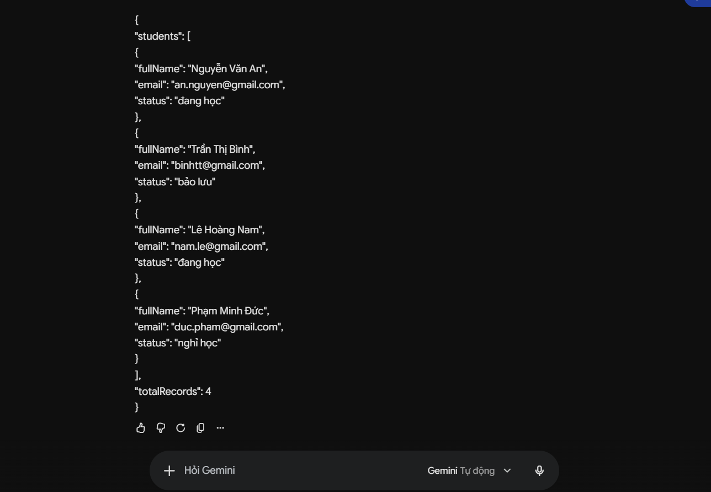

## Viết Promp CREATE: 

**CONTEXT:**

Bạn là chuyên viên xử lý dữ liệu của Phòng Đào tạo trường đại học. Phòng nhận danh sách sinh viên từ nhiều nguồn, dữ liệu có thể không đồng nhất về cách viết họ tên, email và trạng thái học tập. Dữ liệu sau khi chuẩn hóa sẽ được nạp trực tiếp vào hệ thống quản lý.

**REQUEST:**

Đọc danh sách sinh viên trong thẻ <data>...</data>, chuẩn hóa trạng thái học tập và chuyển toàn bộ dữ liệu thành JSON.

**EXPLANATION:**

Ràng buộc bắt buộc:
- Trường "fullName": họ và tên của sinh viên.
- Trường "email": địa chỉ email của sinh viên.
- Trường "status": CHỈ được nhận một trong ba giá trị: "đang học", "bảo lưu", "nghỉ học".
- Tuyệt đối KHÔNG tự ý bổ sung thông tin không có trong dữ liệu.
- Tuyệt đối KHÔNG làm mất bản ghi nào.
- Nếu một trường không xác định được thì dùng giá trị "UNKNOWN".

**ACTION:**

Thực hiện lần lượt các bước:
1. Đọc từng dòng dữ liệu trong thẻ <data>.

2. Tách mỗi dòng thành 3 trường: fullName, email, status.

3. Chuẩn hóa status về đúng 1 trong 3 giá trị cho phép (nếu không khớp thì ghi "UNKNOWN").

4. Chuyển toàn bộ dữ liệu thành JSON.

5. Đếm số bản ghi đầu vào và số phần tử trong mảng "students". Hai số phải bằng nhau rồi mới được xuất kết quả. Gán số đó vào "totalRecords".

**TONE:**

Chính xác, trung lập, như một công cụ xử lý dữ liệu. Không chào hỏi, không bình luận.

**EXTRAS:**

Chỉ trả về JSON thô. KHÔNG dùng Markdown Code Fence, KHÔNG giải thích bên ngoài JSON.
Cấu trúc:
>{
  "students": [
    {
      "fullName": "...",
      "email": "...",
      "status": "..."
    }
  ],
  "totalRecords": <số nguyên>
}

>Nguyễn Văn An - an.nguyen@gmail.com - đang học
>
Trần Thị Bình - binhtt@gmail.com - bảo lưu

Lê Hoàng Nam - nam.le@gmail.com - đang học

Phạm Minh Đức - duc.pham@gmail.com - nghỉ học

## AI Xuất

